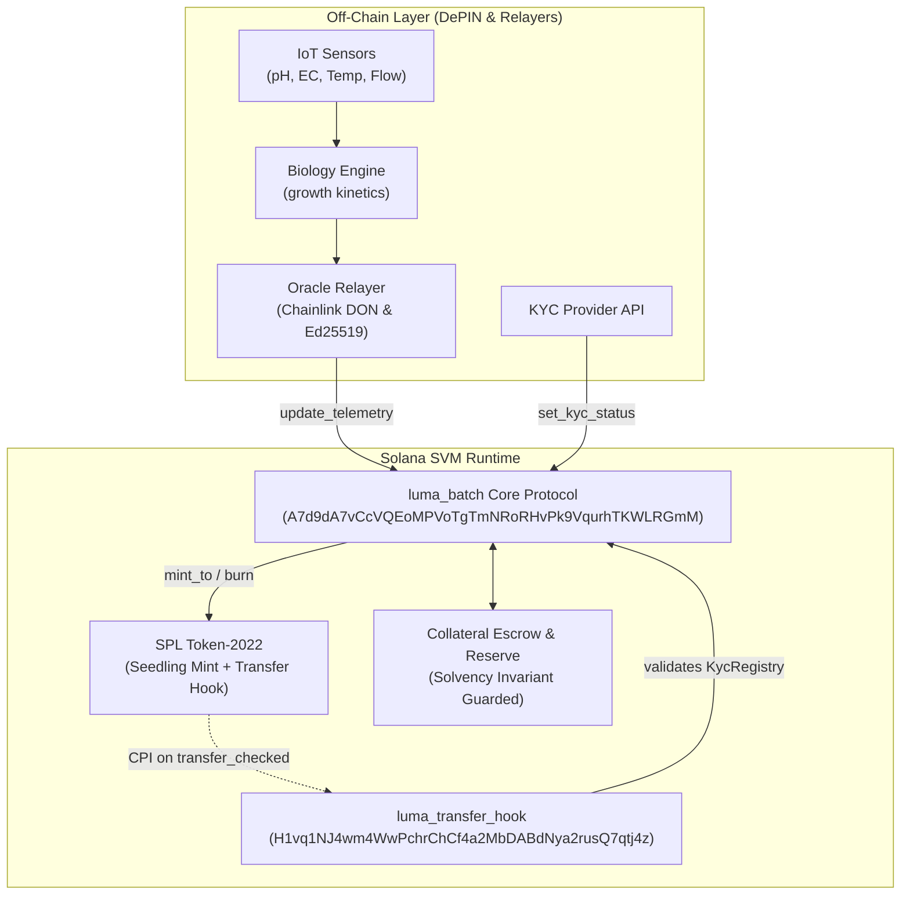

<div align="center">

# 🌿 LumaGrow
### Autonomous AgTech RWA & Real-Time Proof-of-Asset Protocol on Solana

[](https://explorer.solana.com/address/A7d9dA7vCcVQEoMPVoTgTmNRoRHvPk9VqurhTKWLRGmM?cluster=devnet)
[](https://spl.solana.com/token-2022)
[](https://coral-xyz.github.io/anchor/)
[](https://lumagrow.vercel.app)
[](LICENSE)

**Tokenizing 40-day commercial hydroponic lettuce cycles into liquid, compliant, and yield-bearing Real World Assets (RWA).**

[🌐 **Live Demo Application**](https://lumagrow.vercel.app) • [📜 **Core Program (`A7d9dA...`)**](https://explorer.solana.com/address/A7d9dA7vCcVQEoMPVoTgTmNRoRHvPk9VqurhTKWLRGmM?cluster=devnet) • [🔒 **Transfer Hook (`H1vq1N...`)**](https://explorer.solana.com/address/H1vq1NJ4wm4WwPchrChCf4a2MbDABdNya2rusQ7qtj4z?cluster=devnet)

</div>

---

## ⚡ The Value Proposition

Controlled Environment Agriculture (CEA) solves food security and water efficiency, but vertical farms face **predatory financing, 40-to-90 day capital lockups, and zero biological transparency**.

**LumaGrow transforms physical commercial greenhouses into transparent, on-chain capital pools:**
- **Zero Black-Box Risk:** Real-time IoT sensors (pH, EC, water temperature) continuously calculate biological progress and fair asset value.
- **Continuous Liquidity:** Backers can exit mid-cycle (Day 20) via a linear bonding curve instead of waiting for harvest.
- **Autonomous Parametric Insurance:** Instant principal refund on hardware or crop failure—no adjusters, claims, or bureaucratic delay.

---

## 🔬 Core Innovations

| Innovation | Mechanism | Impact |
|:---|:---|:---|
| **1 Token = 1 Seedling** | 0.45 USDC mint price locked 1:1 in an on-chain `SettlementEscrow` vault. | **100% Principal Collateralization.** Escrow solvency is programmatically guaranteed at the SVM layer. |
| **Token-2022 Transfer Hook** | `spl-transfer-hook-interface` extracts wallet owners from bytes `[32..64]`. | **Institutional Compliance.** Transfers to or from non-whitelisted wallets are unconditionally rejected. |
| **Dynamic Fair Value ($FV_t$)** | Valuation model: $FV_t = \frac{Q_{est} \cdot B_t \cdot P_{market} - C_{rem}}{1 + RP_t}$ driven by IoT telemetry. | **Asset Valuation.** Eliminates speculative bubbles by anchoring token value to physical plant biology. |
| **Day 20 Bonding Curve Exit** | Early exit window opens on Day 20 at a guaranteed curve floor of **0.61 USDC**. | **Mid-Cycle Liquidity.** Freed principal is released from escrow; growth premiums draw from `ReserveVault`. |
| **Parametric Circuit Breaker** | Permissionless trigger fires if water temp $> 32.00^\circ\text{C}$ or pump flow $= 0$. | **Instant Protection.** Operations freeze immediately; investors burn tokens to recover 100% principal (0.45 USDC). |

---

## 📐 Architecture at a Glance



---

## 🚀 Judge Quick Start (The "2-Minute Test Drive")

Experience the full 40-day lifecycle live on Solana Devnet with zero test SOL required:

1. **Launch App:** Navigate to **[lumagrow.vercel.app](https://lumagrow.vercel.app)**.
2. **Switch Phantom to Devnet:** *Settings → Developer Settings → Testnet Mode → Select Solana Devnet*.  
   *(Tip: Keep Phantom's Chrome side panel closed so transaction approvals pop up instantly).*
3. **Connect & Open Console:** Click **Connect Wallet** (top right), then open the **Demo Console** (bottom right).
4. **Execute 4-Step Walkthrough:**

| Step | Action | What Happens On-Chain | Result |
|:---:|:---|:---|:---|
| **1** | **Fund seedlings** | Whitelists wallet in `KycRegistry`, faucets test USDC, mints 10 seedlings. | Escrow holds 4.50 USDC collateral. 10 Token-2022 seedlings minted. |
| **2** | **Advance to Day 20 & Exit** | Streams IoT readings (Days 5–20), sells 5 seedlings on bonding curve. | Curve price reaches 0.61 USDC. 5 seedlings burned for 3.05 USDC. |
| **3** | **Trigger Insurance** | Simulates pump failure ($33.5^\circ\text{C}$). Trips parametric circuit breaker. | State switches to *Insurance Triggered*. Remaining tokens refunded at 0.45 USDC. |
| **–** | **Reset & Replay** | Click **"Auto-fill demo key"** and hit *Start new batch*. | Resets state to Day 0 to test harvest settlement. |
| **4** | **Harvest & Redeem** | Streams to Day 40, OTC buyer injects capital, tokens redeemed at 0.7125 USDC. | Tokens burned; 0.7125 USDC/seedling paid out (**+58.3% gross yield**). |

---

## 🛠️ Local Developer Setup & Testing

### Prerequisites
- Rust stable (`rustup default stable`)
- Solana CLI `1.18.26`
- Anchor CLI `0.30.1` (`avm use 0.30.1`)
- Node.js 20+

### Build & Test Commands

```bash
# 1. Clone repository & install dependencies
git clone https://github.com/H-ERDEM/luma.git
cd luma
npm install

# 2. Check Rust workspace compilation
cargo check --workspace

# 3. Run Rust unit tests (15/15 passing)
# Tests checked arithmetic, overflow guards, price floors, and failure predicates
cargo test --workspace

# 4. Run TypeScript edge-case & boundary assertions (10/10 passing)
# Tests zero-division, circuit breaker boundaries, and 60-byte Borsh stability
npx ts-mocha tests/edge_cases.ts

# 5. Run standalone terminal simulation harness (Tracks A, B, and C)
npx ts-node demo-walkthrough.ts
```

---

## 📂 Repository Structure

```
luma/
├── programs/
│   ├── luma-batch/                  # Core RWA Protocol (Anchor 0.30.1)
│   │   └── src/
│   │       ├── lib.rs               # Entrypoint & instruction dispatcher
│   │       ├── state.rs             # ProtocolConfig, BatchVault, KycRegistry
│   │       ├── math.rs              # Checked math, fair value ($FV_t$), solvency guards
│   │       └── instructions/        # Modular instructions (fund, mint, exit, settle)
│   └── luma-transfer-hook/          # Token-2022 Transfer Hook Program
│       └── src/lib.rs               # ExtraAccountMetaList & Execute hook handler
├── backend/                         # Off-Chain Oracle & IoT DePIN Simulator
│   ├── src/
│   │   ├── server.ts                # Express REST API (/api/live, /api/faucet, /api/demo)
│   │   ├── simulator.ts             # 40-day biological growth simulator
│   │   └── chain.ts                 # Anchor & Solana Web3 RPC client
├── frontend/                        # Next.js 14 Web Application
│   ├── components/                  # DemoConsole, Launchpad, LivePoAPanel, SeedTray
│   └── lib/                         # Anchor RPC clients, transaction builders, formats
└── tests/
    ├── luma.ts                      # Full end-to-end integration test suite
    └── edge_cases.ts                # Math safety, overflow, and zero-division test suite
```

---

## 🛡️ Security & Invariant Guarantees

- **Solvency Invariant:** `escrow_usdc >= circulating_supply * unit_price` is strictly re-asserted after every withdrawal or exit.
- **Double-Dipping Prevention:** Tokens are burned via Token-2022 CPI **before** funds are released from any vault.
- **Anti-Spoofing Hook:** `assert_is_transferring()` ensures the transfer hook can only be invoked by Token-2022 CPI, never standalone.
- **Cryptographic Replay Resistance:** Oracle updates require strictly monotonic `sequence` increments and instruction-level Ed25519 precompile signatures.

---

<div align="center">

**Built for the Colosseum Solana Hackathon**  
*Empowering decentralized agricultural infrastructure on the world's highest performance blockchain.*

</div>
