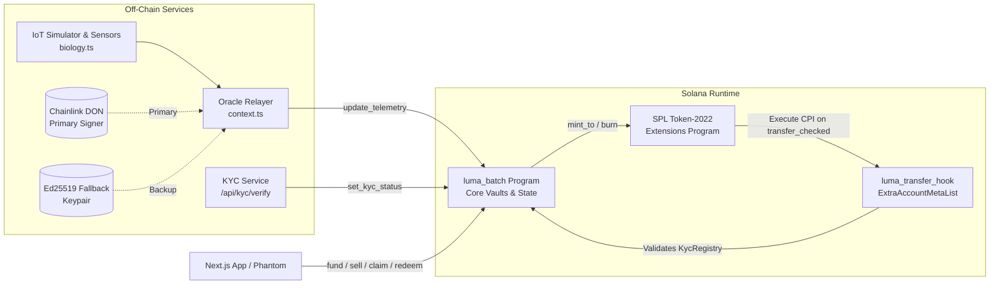

# 🌿 LumaGrow — Autonomous AgTech RWA & Real-Time Proof-of-Asset Protocol

> **Colosseum Hackathon Submission** | **Track:** Real World Assets (RWA) & DePIN / Infrastructure  
> **Live Demo:** [https://lumagrow.vercel.app](https://lumagrow.vercel.app) *(Solana Devnet)*  
> **Live Programs on Devnet:**  
> Core Protocol: [`luma_batch` (`A7d9dA7vCcVQEoMPVoTgTmNRoRHvPk9VqurhTKWLRGmM`)](https://explorer.solana.com/address/A7d9dA7vCcVQEoMPVoTgTmNRoRHvPk9VqurhTKWLRGmM?cluster=devnet)  
> Token-2022 Transfer Hook: [`luma_transfer_hook` (`H1vq1NJ4wm4WwPchrChCf4a2MbDABdNya2rusQ7qtj4z`)](https://explorer.solana.com/address/H1vq1NJ4wm4WwPchrChCf4a2MbDABdNya2rusQ7qtj4z?cluster=devnet)

---

## Executive Summary

**LumaGrow** is a Solana-native Real World Asset (RWA) protocol that tokenizes 40-day hydroponic lettuce cycles into liquid, compliant, and yield-bearing digital assets. 

By integrating **Solana Token-2022 Transfer Hooks** for on-chain KYC validation, real-time **IoT telemetry Proof-of-Asset (PoA)** oracles, a **linear bonding curve** for mid-cycle liquidity, and an autonomous **parametric insurance circuit breaker**, LumaGrow bridges physical commercial greenhouse agriculture with decentralized finance.

```
       [Investor / Backer]  ---(0.45 USDC)---> [Collateral Escrow Vault]
               |                                       |
       (Token-2022 Seedling)                           | (100% Principal Backed)
               |                                       v
      [Transfer Hook] -----------> [On-Chain KycRegistry Whitelist]
               |
     [IoT Telemetry (PoA)]
       • pH (0.00 - 14.00)
       • EC (µS/cm)
       • Water Temp (°C) & Flow Rate
               |
               +---> [Path 1 (Day 20 Early Exit)]: Linear Bonding Curve Liquidity
               +---> [Path 2 (Day 40 Harvest)]: OTC Settle -> 0.7125 USDC Redemption
               +---> [Path 3 (Parametric Circuit Breaker)]: Critical Outage -> 100% Refund
```

---

## 1. The Problem: Agricultural Financing Bottlenecks

1. **Predatory Capital & High Lockups:** Controlled Environment Agriculture (CEA) and vertical farms require heavy upfront working capital (seeds, nutrients, electricity, labor). Traditional bank loans carry high interest rates and take months to underwrite.
2. **Zero Transparency ("Black-Box" Farming):** Off-chain investors have zero visibility into biological crop health until harvest. Failures are hidden until capital is already lost.
3. **Complete Liquidity Drought:** Investors cannot exit midway through a 40-to-90 day crop cycle. Capital remains completely frozen.
4. **Bureaucratic Insurance Settlements:** When a pump breaks or greenhouse temperatures spike, traditional agricultural insurance takes 6–12 months of paperwork and adjusters to pay out claims.

---

## 2. The Solution: Core Innovations

### 1. 1 Token = 1 Physical Seedling (Collateralized Escrow Vault)
- **Token Mint Price:** Exactly **0.45 USDC** (6 decimals) per token. No fractional seedlings (`decimals = 0`).
- **Principal Guarantee:** Every micro-USDC paid is locked into an on-chain `SettlementEscrow` PDA vault. The solvency invariant is enforced at the SVM level:
  $$\text{escrow\_balance} \ge \text{circulating\_supply} \times 0.45\text{ USDC}$$

### 2. Institutional Compliance via Token-2022 Transfer Hooks
- Every seedling token mint is extended with an `spl-transfer-hook-interface`.
- Every token transfer (`transfer_checked`) dynamically resolves the sender and receiver's wallet public keys from byte offsets `[32..64]` and cross-references the on-chain `KycRegistry` PDA.
- **Security Guarantee:** Any transfer involving an unverified address is unconditionally rejected by the Solana runtime.

### 3. Dynamic Fair Value ($FV_t$) Driven by IoT Biological Telemetry
Token valuation does not rely on speculative AMM bubbles. It tracks an on-chain biological fair value function:
$$FV_t = \frac{Q_{est} \cdot B_t \cdot P_{market} - C_{rem}}{1 + RP_t}$$
- $Q_{est}$: Estimated yield per plant (250 g).
- $P_{market}$: Market lettuce price per kg (3.20 USDC/kg).
- $B_t$: Biological growth coefficient ($0\% \to 100\%$) modeled by $B(t) = \frac{1 - e^{-t/\tau}}{1 - e^{-40/\tau}}$ (calibrated so $B(20) = 85\%$).
- $C_{rem}$: Linearly diminishing remaining operational costs (nutrients, power).
- $RP_t$: Biological risk premium.

### 4. Mid-Cycle Liquidity via Bonding Curve (Day 20 Early Exit)
- Investors who need liquidity before harvest can sell tokens back to the bonding curve starting on Day 20.
- **Curve Price Floor:** Guaranteed at $\max(FV_t, 0.45\text{ USDC})$. At Day 20, the price is **0.61 USDC**.
- **Solvency Isolation:** The 0.45 USDC principal is unlocked from `SettlementEscrow` because burned tokens reduce required collateral. The growth premium ($0.61 - 0.45 = 0.16\text{ USDC}$) is paid from a separate `ReserveVault`. Remaining holders' principal is never touched.

### 5. Harvest Settlement (Day 40)
- On Day 40, commercial OTC supermarket buyers deposit wholesale proceeds into escrow.
- Seedling tokens are burned, and investors redeem at **0.7125 USDC** per seedling (a **+58.3% gross return**, net of a 6.25% protocol fee).

### 6. Autonomous Parametric Insurance (Circuit Breaker)
- If sensor telemetry reports water temperature $> 32.00^\circ\text{C}$ or nutrient pump flow $= 0\text{ ml/min}$ (crop-lethal conditions), the parametric circuit breaker triggers.
- Triggering is **permissionless**: any party can submit the transaction, and the contract relies strictly on cryptographic oracle proofs.
- Standard operations freeze, and investors immediately claim **100% of their initial principal (0.45 USDC/token)** directly from the collateral vault.

---

## 3. Economic Model & Price Trajectory

| Cycle Day | Biological Progress ($B_t$) | Calculated Fair Value ($FV_t$) | Bonding Curve Exit Price | Status / Action |
|:---:|:---:|:---:|:---:|:---|
| **Day 0** | 0.0% | -0.4400 USDC | **0.4500 USDC** | Batch opens; Seedlings minted & collateralized |
| **Day 15** | 75.1% | +0.4987 USDC | **0.4987 USDC** | Vegetative growth phase; IoT telemetry streaming |
| **Day 20** | 85.0% | +0.6100 USDC | **0.6100 USDC** | **Early Exit Window Opens**; Free liquidity exit |
| **Day 40** | 100.0% | +0.7600 USDC | **0.7600 USDC** | **Harvest Maturity**; Redeemed at **0.7125 USDC** net |

---

## 4. System Architecture



### Account & PDA Directory

| Account | Owning Program | Seeds | Purpose |
|---|---|---|---|
| `ProtocolConfig` | `luma_batch` | `[b"config"]` | Global authorities (admin, KYC, DON, fallback, USDC mint). |
| `KycRegistry` | `luma_batch` | `[b"kyc", wallet_pubkey]` | On-chain compliance whitelist record per wallet. |
| `BatchVault` | `luma_batch` | `[b"batch", batch_id.to_le_bytes()]` | Batch state, token mint authority, active telemetry, curve prices. |
| `SettlementEscrow` | `luma_batch` | `[b"escrow", batch_vault_key]` | Collateral accounting vault for principal protection. |
| `Escrow USDC ATA` | SPL Token | Associated Token Account | Physical USDC collateral backing circulating tokens. |
| `ReserveVault` | `luma_batch` | `[b"reserve", batch_vault_key]` | Floating liquidity reserve funding early exit growth premiums. |
| `ExtraAccountMetaList` | `luma_transfer_hook` | `[b"extra-account-metas", mint_key]` | TLV directory resolving dynamic source/dest KYC PDAs. |

---

## 5. Monorepo Structure

```
luma/
├── programs/
│   ├── luma-batch/                  # Core RWA Protocol (Anchor 0.30.1)
│   │   └── src/
│   │       ├── lib.rs               # Program entrypoints & instruction dispatch
│   │       ├── state.rs             # ProtocolConfig, BatchVault, KycRegistry
│   │       ├── math.rs              # Checked arithmetic, fair value, solvency assertions
│   │       ├── constants.rs         # PDA seeds, temperature thresholds, scale factors
│   │       ├── errors.rs & events.rs# Structured errors & audit events
│   │       └── instructions/        # Modular handlers: fund, mint, telemetry, exit, settle
│   └── luma-transfer-hook/          # Token-2022 Transfer Hook Program
│       └── src/lib.rs               # ExtraAccountMetaList & Execute handler
├── backend/                         # Off-chain Oracle, IoT Simulator & API
│   ├── src/
│   │   ├── server.ts                # Express API (/api/live, /api/faucet, /api/demo)
│   │   ├── simulator.ts             # 40-day biological state machine simulator
│   │   ├── biology.ts               # Photosynthesis, EC/pH nutrient kinetics
│   │   ├── chain.ts                 # Anchor & Solana Web3 RPC client
│   │   └── keys.ts                  # Ed25519 & DON keypair management
├── frontend/                        # Next.js 14 Web Application
│   ├── app/                         # App Router (layout, page, Tailwind)
│   ├── components/
│   │   ├── DemoConsole.tsx          # 1-Click Judge & Auditor Interactive Walkthrough
│   │   ├── Launchpad.tsx            # Investor portal: Mint, Early Exit & Redeem
│   │   ├── LivePoAPanel.tsx         # Real-time Proof-of-Asset telemetry gauge
│   │   ├── SeedTray.tsx             # Animated 40-day hydroponic seedling tray
│   │   └── KycBadge.tsx             # On-chain whitelist status indicator
├── tests/
│   ├── luma.ts                      # Full end-to-end integration test suite
│   └── edge_cases.ts                # Math bounds, overflow, and zero-division test suite
├── demo-walkthrough.ts              # Standalone 3-track terminal simulation harness
├── Anchor.toml                      # Anchor workspace configuration
└── Cargo.toml                       # Cargo workspace configuration
```

---

## 6. Evaluation Guide for Judges

### Track 1: Interactive Live Devnet Demo (Fastest — 2 Minutes)

1. Open the live deployment: **[https://lumagrow.vercel.app](https://lumagrow.vercel.app)**
2. Put Phantom on **Solana Devnet** (*Settings → Developer Settings → Testnet Mode → Solana Devnet*).
   *(Keep Phantom's Chrome side panel closed to allow pop-up approvals).*
3. Connect your wallet and open the **Demo Console** (bottom right).
4. Walk through the 4 scenario steps:

| Step | Button | Action Performed | What You See On-Chain |
|:---:|---|---|---|
| **1** | **Fund seedlings** | Whitelists your wallet in `KycRegistry`, faucets test USDC, buys 10 seedlings. | Collateral vault increases to 4.50 USDC. 10 Token-2022 seedlings minted. |
| **2** | **Advance to Day 20 & Exit Early** | Streams IoT readings for days 5, 10, 15, 20. Sells 5 seedlings back to bonding curve. | Curve price hits 0.61 USDC. 5 seedlings burned for 3.05 USDC. Escrow solvency verified. |
| **3** | **Trigger Failure & See Insurance** | Simulates pump failure ($33.5^\circ\text{C}$, 0 flow). Activates circuit breaker. | Status switches to *Insurance Triggered*. Remaining seedlings refunded at 100% principal (0.45 USDC). |
| **–** | **Start New Batch** | Click **"Auto-fill demo key"** and press *Start new batch*. | Resets state to Day 0 to test harvest redemption. |
| **4** | **Harvest, Burn & Redeem** | Advances to Day 40, OTC buyer injects capital, tokens redeemed at 0.7125 USDC. | Tokens burned; 0.7125 USDC/seedling paid (+58.3% return). Batch closes. |

---

### Track 2: Terminal Simulation Harness

Run the offline simulation harness to test all 3 mathematical execution tracks in memory:
```bash
npx ts-node demo-walkthrough.ts
```
```text
==============================================================================
🌿  LUMAGROW PROTOCOL EXECUTION SUMMARY MATRIX
==============================================================================
┌─────────┬──────────────────────────────────┬─────────┬─────────────┬───────────┬────────────────────────────────────┐
│ (index) │ Track                            │ ExitDay │ InitialCost │ Payout    │ NetReturn                          │
├─────────┼──────────────────────────────────┼─────────┼─────────────┼───────────┼────────────────────────────────────┤
│ 0       │ 'Track A (Full Maturity)'        │ 40      │ '$45.00'    │ '$60.00'  │ '+33.33%'                          │
│ 1       │ 'Track B (Day 20 Early Exit)'    │ 20      │ '$45.00'    │ '$44.625' │ '-0.83% (Net of 15% Liquidity Tax)'│
│ 2       │ 'Track C (Parametric Insurance)' │ 15      │ '$45.00'    │ '$45.00'  │ '0.00% (100% Principal Protected)' │
└─────────┴──────────────────────────────────┴─────────┴─────────────┴───────────┴────────────────────────────────────┘
```

---

### Track 3: Local Compilation & Test Execution

#### Prerequisites
- Rust stable (`rustup default stable`)
- Solana CLI `1.18.26`
- Anchor CLI `0.30.1` (`avm use 0.30.1`)
- Node.js 20+

#### 1. Compile the Rust Programs
```bash
cargo check --workspace
```

#### 2. Run Rust Unit Tests (15 Tests Passing)
```bash
cargo test --workspace
```
*Verifies intermediate i128 checked math, extreme market prices, zero-division guards, temperature threshold boundaries, and Borsh layout stability.*

#### 3. Run TypeScript Edge-Case Test Suite (10 Tests Passing)
```bash
npx ts-mocha tests/edge_cases.ts
```
*Verifies zero-yield edge cases, pump stoppage detection, undercollateralization deficit distributions, and 60-byte telemetry binary stability.*

---

## 7. Security & Risk Mitigations

- **Integer Overflow Protection:** All arithmetic operations in `math.rs` utilize `checked_add`, `checked_sub`, `checked_mul`, and `checked_div` with `i128` intermediate calculations to eliminate overflow/underflow vulnerabilities.
- **Double-Dipping Elimination:** All withdrawal pathways (`sell_to_bonding_curve`, `claim_default_refund`, `redeem_and_burn`) execute token burns via Token-2022 CPI **before** transferring USDC out of vaults.
- **Anti-Spoofing Hook Protection:** `assert_is_transferring()` unpacks the `TransferHookAccount` extension to guarantee the hook is exclusively executed within a valid Token-2022 transfer CPI context.
- **Cryptographic Replay Resistance:** Telemetry updates enforce strictly monotonic `sequence` increments and instruction-level Ed25519 precompile signatures.

---

## 8. License & Acknowledgements

Developed for the **Colosseum Solana Hackathon**. Licensed under the [MIT License](LICENSE).
