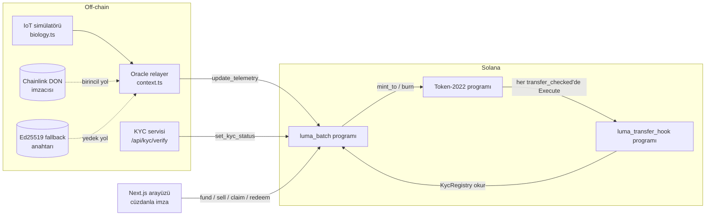

# LUMA — AgTech Canlı Varlık Kanıtı (Proof-of-Asset) ve Token-2022

40 günlük hidroponik marul partilerini Solana üzerinde tokenleştiren protokol. Her token bir fideyi temsil eder. Fide 0,45 USDC'ye satılır ve ödenen USDC'nin tamamı teminat kasasında kilitli kalır. Token'ın değeri sensör verisiyle beslenen bir adil değer formülüne göre büyür. Yatırımcı üç yoldan çıkabilir: 20. günde bonding curve'e satarak, kritik arızada parametrik sigortayla anaparasını geri alarak ya da 40. günde hasat itfasıyla. Token'ların her transferi, Token-2022 transfer hook'u üzerinden zincir üstü KYC kaydına tabidir.

| Katman | Dizin | Teknoloji |
|---|---|---|
| Zincir üstü | `programs/luma-batch`, `programs/luma-transfer-hook` | Rust, Anchor 0.30.1, Token-2022 |
| Oracle / simülatör | `backend/` | Node 20, Express, TypeScript |
| Arayüz | `frontend/` | Next.js 14 (App Router), Tailwind, Solana Wallet Adapter |
| Entegrasyon testleri | `tests/luma.ts` | ts-mocha, `anchor test` |

---

## 1. Mimari



### Ekonomik model

Adil değer, mikro-USDC cinsinden ve fide başına şu formülle hesaplanır:

$$FV_t = (Q_{est} \times P_{market} \times B_t) - (C_{rem} \times (1 - B_t)) - RP_t$$

Bonding curve fiyatı `max(FV_t, 0,45)` olarak tanımlanır, yani fiyat anapara tabanının altına inmez. Simülatördeki parametreler şunlardır: Q = 250 g, P = 3,20 USDC/kg, toplam maliyet 0,40 USDC (doğrusal olarak azalır), RP = 0,04 USDC. B_t şu fonksiyonla hesaplanır: `B(t) = (1 − e^(−t/τ)) / (1 − e^(−40/τ))`. τ değeri, B(20) = 0,85 olacak şekilde seçilmiştir.

| Gün | B_t | FV_t | Curve fiyatı |
|---|---|---|---|
| 0 | %0 | −0,44 | **0,45** |
| 15 | %75,1 | 0,4987 | 0,4987 |
| 20 | %85 | 0,61 | **0,61** |
| 40 | %100 | 0,76 | **0,76** |

Hasat itfası `max(0,76 × (1 − %6,25), 0,45)` formülüyle **0,7125 USDC**'dir. Aradaki %6,25 protokol payıdır (`harvest_fee_bps = 625`).

### Hesap / PDA haritası

| Hesap | Program | Seed'ler | İçerik |
|---|---|---|---|
| `ProtocolConfig` | luma_batch | `["config"]` | admin, kyc_authority, don_authority, fallback_authority, transfer_hook_program, usdc_mint, batch_count |
| `KycRegistry` | luma_batch | `["kyc", wallet]` | wallet, is_approved, updated_at |
| `BatchVault` | luma_batch | `["batch", batch_id (u64 LE)]` | ekonomik parametreler, durum, son telemetri, FV, curve/iade/itfa fiyatları. Mint, freeze ve hook yetkisidir. |
| Parti mint'i (Token-2022) | luma_batch | `["mint", batch_vault]` | 0 ondalık, TransferHook uzantısı → luma_transfer_hook |
| `SettlementEscrow` | luma_batch | `["escrow", batch_vault]` | anapara teminatı muhasebesi |
| Escrow USDC | ATA | ATA(usdc_mint, settlement_escrow) | teminat USDC'si |
| `ReserveVault` | luma_batch | `["reserve", batch_vault]` | erken çıkış primi likiditesi |
| Rezerv USDC | ATA | ATA(usdc_mint, reserve_vault) | rezerv USDC'si |
| ExtraAccountMetaList | luma_transfer_hook | `["extra-account-metas", mint]` | TLV: luma_batch program ID'si, kaynak KYC PDA'sı, hedef KYC PDA'sı |

Transfer hook'un ek hesapları şöyle çözülür. Execute talimatının hesap indeksleri sırasıyla şunlardır: 0 kaynak, 1 mint, 2 hedef, 3 sahip, 4 meta listesi. Bunlara 3 ek hesap eklenir:

- 5: `luma_batch` program ID'si (sabit adres).
- 6: `PDA(luma_batch, ["kyc", kaynak_hesap.data[32..64]])`.
- 7: `PDA(luma_batch, ["kyc", hedef_hesap.data[32..64]])`.

Token hesabının 32–64. baytları hesap sahibidir. Bu sayede istemci ekstra hesapları elle vermez; `@solana/spl-token` içindeki `createTransferCheckedWithTransferHookInstruction` hepsini otomatik çözer.

### Talimatlar

| Talimat | Yetki | Açıklama |
|---|---|---|
| `initialize_config` | admin | Yetki anahtarlarını ve USDC mint'ini sabitler |
| `update_config` | admin | Anahtar rotasyonu |
| `set_kyc_status` | kyc_authority | KYC kaydını açar veya günceller |
| `initialize_batch` | admin | Parti, escrow ve rezerv kasaları, USDC ATA'ları; mint adresini kaydeder |
| `initialize_batch_mint` | admin | Token-2022 mint'i (freeze + transfer hook). `initialize_batch` ile **aynı işlemde**, ondan sonra gönderilir (SBF stack sınırı nedeniyle ayrıldı) |
| `initialize_extra_account_meta_list` (hook) | herkes | Mint için KYC meta listesini bir kez yazar |
| `fund_reserve` | herkes | Rezerv kasasına serbest likidite ekler |
| `fund_and_mint` | KYC onaylı alıcı | `adet × 0,45` USDC escrow'a gider, aynı adet token basılır (gün ≤ `funding_close_day`) |
| `update_telemetry` | DON imzacısı **veya** Ed25519 fallback | Sıra numarası, tazelik, gün monotonluğu ve aralık kontrolleri; FV_t ve curve fiyatını günceller |
| `sell_to_bonding_curve` | KYC onaylı sahip | 20 ≤ gün < 40; token yakılır, ödeme yapılır, solvency yeniden doğrulanır |
| `trigger_parametric_default` | herkes | Son telemetri > 32 °C veya akış = 0 ise parti `Defaulted` olur |
| `claim_default_refund` | sahip | Token yakılır, iade fiyatından USDC ödenir |
| `settle_harvest` | parti admini | Gün ≥ 40; OTC USDC'si yatırılır, itfa fiyatı sabitlenir |
| `redeem_and_burn` | sahip | Token yakılır, 0,7125 USDC/adet ödenir |

### Üç mimari çözüm

**1. Transfer hook ve KYC.** Hook, `#[interface(spl_transfer_hook_interface::execute)]` ile SPL arayüz ayırıcısına bağlanır. Her transferde kaynak ve hedef sahiplerinin `KycRegistry` hesapları `Account<KycRegistry>` olarak yüklenir. Sahibi (owner) ve seed'leri doğrulanır, ardından `is_approved` kontrol edilir. Kayıt yoksa hesap yüklenemez ve transfer reddedilir. Kayıt varsa ama onay yoksa `SourceNotKycApproved` veya `DestinationNotKycApproved` hatası döner. Hook ayrıca kaynak hesabın `TransferHookAccount.transferring` bayrağını kontrol eder; böylece hook'un Token-2022 dışından doğrudan çağrılması engellenir. Protokolün kendi akışları (mint, sat, iade, itfa) transfer yerine `mint_to` ve `burn` kullandığı için hook'a ve ekstra hesaplara ihtiyaç duymaz.

**2. Solvency invariantı.** Bütün çıkış yollarında şu koşul korunur:

$$\text{escrow\_usdc} \ge \text{dolaşım} \times 0{,}45$$

Erken çıkışta ödeme `adet × curve_fiyatı` olarak hesaplanır ve iki kaynaktan karşılanır:
- Escrow yalnızca serbest fazlasını öder: `escrow − (kalan_dolaşım × 0,45)`. Bu tutar, yakılan token'ların açığa çıkan teminatıdır.
- Kalan büyüme primini `ReserveVault` öder. Rezerv yetersizse işlem `InsufficientExitLiquidity` ile reddedilir.

Transferlerden sonra mint arzı ve escrow bakiyesi yeniden yüklenir, `assert_solvent` çalıştırılır. İhlal varsa işlem `SolvencyInvariantViolated` ile geri alınır. Böylece kalan sahiplerin teminatına hiçbir koşulda dokunulmaz.

**3. Çift katmanlı oracle.** `update_telemetry` talimatında iki yol vardır:
- `relayer == config.don_authority` ise işlem DON yolundan kabul edilir.
- Aksi halde, hemen önceki talimat Ed25519 precompile olmalıdır. Program bu talimatı Instructions sysvar'ından okur ve şunları doğrular: imza sayısı 1, tüm offset indeksleri `u16::MAX` (yani veri aynı talimatta), açık anahtar `config.fallback_authority`, mesaj ise `"LUMA_TELEMETRY_V1" || batch_vault || borsh(payload)`.

İmzanın kendisini runtime precompile doğrular. Mesaj batch adresiyle bağlandığı için imza başka bir partide yeniden kullanılamaz. Artan `sequence` numarası replay saldırısını engeller. Son kaynak, `last_oracle_source` alanına yazılır.

> **Chainlink notu:** Chainlink, Solana'da fiyat beslemeleri sunar; ancak özel IoT telemetrisini doğrudan bir programa yazan hazır bir DON servisi yoktur. Bu nedenle "DON yolu", config'te kayıtlı bir imzacı anahtarı olarak modellenmiştir. Üretimde bu anahtar, Chainlink düğüm operatörünün veya bir CRE/Functions iş akışının raporlarını zincire yazan transmitter olur. Demoda bu anahtarı backend tutar (`backend/.keys/don-authority.json`).

### Bilinçli istisnalar ve varsayımlar
- **İki `UncheckedAccount` var.** ExtraAccountMetaList TLV formatındadır ve Anchor discriminator'ı taşımaz. Instructions sysvar'ının da bir Anchor tipi yoktur. İkisi de seeds veya sabit adresle kilitlidir ve `/// CHECK` ile belgelenmiştir. Hook'taki `owner` hesabı da Execute arayüzü gereği tiplenemez; hook bu hesabı okumaz.
- **Gün sayacı oracle'dan gelir.** `day` değeri zincir saatinden değil telemetriden okunur; zaman makinesi bu sayede çalışır. Bu bir güven varsayımıdır. Üretimde `day`, `initialize_batch` anındaki `Clock` değerinden türetilmelidir.
- **Escrow, demoda anaparanın tamamını tutar.** Gerçek işletmede üretim maliyetleri için kontrollü bir çekim mekanizması gerekir.
- **USDC mock'tur.** Faucet ve OTC simülasyonu için admin'in basabildiği 6 ondalıklı bir mint kullanılır. Gerçek USDC'ye geçiş, `initialize_config` çağrısına Circle mint adresini vermekten ibarettir.

---

## 2. Yerel ağ kurulumu ve testler

### Gereksinimler

| Araç | Sürüm |
|---|---|
| Rust | stable (rustup) |
| Solana CLI | 1.18.26 (bu projenin derlendiği ve test edildiği sürüm). SBF araç zinciri `--tools-version v1.43` ile seçilir |
| Anchor CLI | 0.30.1 (`avm install 0.30.1 && avm use 0.30.1`) |
| Node.js | 20+ |
| Cüzdan | Phantom, Solflare veya Backpack (Wallet Standard ile otomatik algılanır) |

`Cargo.lock`, Rust 1.79 ile uyumlu sürümlere sabitlenmiştir (`blake3 1.5.5` vb.). Lockfile'ı silerseniz, daha yeni kasalar edition 2024 gerektirdiği için SBF derlemesi başarısız olabilir.

### Program ID'lerini eşitleme

```bash
npm install                                      # kök: test bağımlılıkları
anchor build -- --tools-version v1.43            # ilk derleme target/deploy/*-keypair.json üretir
anchor keys sync                                 # declare_id! ve Anchor.toml'u kendi anahtarlarınıza eşitler
anchor build -- --tools-version v1.43            # ID'ler güncellendikten sonra yeniden derle
```

**Derleme notları**
- `--tools-version v1.43` olmadan varsayılan araç zinciri bu depodaki bağımlılıkları derleyemeyebilir.
- Derleme çıktısında `Stack offset … exceeded max offset of 4096` satırı çıkmamalıdır. Bu hata çıkış kodunu **bozmaz**, yalnızca uyarı olarak yazılır; her derlemeden sonra çıktıda aratın (`anchor build … 2>&1 | grep "Stack offset"`).
- `target/deploy/*-keypair.json` dosyaları program ID'lerinizdir ve `anchor clean` onları siler. Yedekleyin ve izinlerini kısıtlayın (`chmod 600`).
- Başka bir `cargo` komutu `PATH`'inizde Rust'ınkinden önce geliyorsa `cargo build-sbf` bulunamaz; `which cargo` ile `~/.cargo/bin/cargo` olduğunu doğrulayın.
- macOS'ta `anchor test` ledger'ı açarken `._genesis.bin` hatası alırsanız `COPYFILE_DISABLE=1 anchor test` kullanın.

`luma_batch`, hook program ID'sini kodda sabit tutmaz; `ProtocolConfig.transfer_hook_program` alanından okur. Hook ise `luma_batch::ID` değerini crate bağımlılığından alır. Bu nedenle `keys sync` dışında elle düzenlemeniz gereken bir ID yoktur.

### Entegrasyon testleri

```bash
anchor test
```

Bu komut yerel validator'ı başlatır, iki programı yükler ve `tests/luma.ts` dosyasını çalıştırır. Testler şunları kapsar:
- Rust ve TS arasındaki serileştirme vektörü
- KYC onaysız alım reddi
- Transfer hook'un KYC'li alıcıya izin verip onaysız alıcıyı reddetmesi
- DON ve Ed25519 yollarının kabulü; yetkisiz imzacı, yanlış Ed25519 anahtarı, replay ve geçersiz B_t reddi
- 20. gün çıkışı: 30,5 USDC = 22,5 escrow + 8 rezerv; escrow tam teminat seviyesinde kalır
- Hasat: 0,7125 USDC itfa
- Sigorta: önce arıza yokken tetikleme reddi, sonra 0,45 USDC iade

Saf Rust birim testleri (FV formülü ve serileştirme düzeni) için:

```bash
cargo test -p luma-batch --lib
```

### Uçtan uca yerel demo

```bash
# Terminal 1 — validator
solana-test-validator --reset

# Terminal 2 — programları yükle
solana config set --url localhost
anchor deploy --provider.cluster localnet

# Terminal 3 — backend
cd backend
cp .env.example .env
npm install
npm run bootstrap           # mock USDC, ProtocolConfig, Parti #0, hook meta listesi, rezerv, gün 0 telemetrisi
npm run dev                 # http://localhost:4000

# Terminal 4 — frontend
cd frontend
cp .env.example .env.local
npm install
npm run dev                 # http://localhost:3000
```

Cüzdanınızı yerel ağa bağlayın. Örneğin Phantom'da: Ayarlar → Geliştirici ayarları → Testnet modu → Solana Localnet. Jüri konsolunun 1. adımı cüzdanınıza SOL ve test USDC'si gönderir.

### Ortam profilleri (localnet ↔ devnet)

Gerçek `.env*` dosyaları git'e girmez; şablonlar `*.example` olarak izlenir.

| | Backend | Frontend |
|---|---|---|
| Localnet | `backend/.env.localnet` (`.env.localnet.example`'dan) | `frontend/.env.localnet` |
| Devnet | `backend/.env.devnet` (`.env.devnet.example`'dan) | `frontend/.env.devnet` |

```bash
# Backend: ENV_FILE ile profil seçilir (varsayılan .env)
cd backend
npm run bootstrap:devnet && npm run dev:devnet     # ya da bootstrap:localnet / dev:localnet

# Frontend: seçilen profili .env.local'e kopyalar, sonra yeniden başlatın
cd frontend
npm run use:devnet && npm run dev                  # ya da use:localnet
```

Devnet profili ayrı bir admin anahtarı (`backend/.keys/devnet-admin.json`), ayrı oracle anahtar klasörü (`.keys/devnet`) ve ayrı durum klasörü (`.data/devnet`) kullanır; localnet ayarlarınız etkilenmez. RPC adresi sağlayıcı anahtarı içerebilir: `.env.devnet` dosyalarına yazın, `*.example` dosyalarına yazmayın. Backend adresi `/api/health` yanıtında ve loglarda maskelenir.

### Phantom ile test

- Phantom'da **Ayarlar → Geliştirici ayarları → Testnet modu** açık ve ağ **Solana Devnet** (ya da Localnet) olmalıdır.
- ⚠️ **Phantom'un Chrome yan paneli açıkken onay penceresi açılmayabilir** ve arayüz "Phantom'da onay bekleniyor…" durumunda kalır. Onay penceresi açılmadıysa Phantom yan panelini kapatıp tekrar deneyin. Yine de görünmezse tarayıcı araç çubuğundaki Phantom simgesine tıklayın. Bekleyen bir istek takılı kalırsa Phantom'dan reddedin.
- Jüri konsolundaki adımlar bir partiyi kapatabilir (3. ve 4. adımlar). Kapalı partide 1-4. adımlar devre dışıdır; önce **Yeni parti başlat**'a basın.

### Backend API

| Yöntem | Yol | Açıklama |
|---|---|---|
| GET | `/api/telemetry/current` | Zincirdeki son telemetri, canlı sensör okuması, oracle geçmişi, teorik eğri |
| GET | `/api/snapshot` | Durum ve telemetri tek yanıtta (arayüz bunu yoklar). Kısa süreli paylaşılan önbellek; `?fresh=1` ile atlanır |
| GET | `/api/batch/state` | Aktif parti adresleri, durum, fiyatlar, kasa bakiyeleri |
| GET | `/api/kyc/:wallet` | KYC kaydı |
| POST | `/api/kyc/verify` | `{ wallet }` — cüzdanı zincirde onaylar (demo KYC sağlayıcısı). Zaten onaylıysa zincire yazmaz (`alreadyApproved`). IP başına sınırlıdır |
| GET | `/api/idl/:name` | `luma_batch` veya `luma_transfer_hook` IDL'i |
| POST | `/demo/advance-days` | `{ targetDay }` — 5 günlük adımlarla ilerler; DON ve Ed25519 yollarını dönüşümlü kullanır |
| POST | `/demo/trigger-outage` | 33,5 °C ve akış 0 telemetrisini yazar, ardından `trigger_parametric_default` çağırır |
| POST | `/demo/settle-harvest` | Gerekirse 40. güne ilerler; `dolaşım × 250 g × 3,20 USDC/kg` OTC tutarıyla uzlaştırır |
| POST | `/demo/faucet` | `{ wallet }` — cüzdanın test USDC bakiyesini üst sınıra (varsayılan 100) **tamamlar**, en az 0,05 SOL gönderir. Cüzdan başına ve günlük sınırlara tabidir (aşağıya bakın) |
| POST | `/demo/reset` | Yeni parti başlatır (sigorta ve hasat senaryoları partiyi kapatır). `DEMO_RESET_TOKEN` tanımlıysa `x-demo-token` başlığı gerekir |


### Demo uç noktalarının korumaları

Demo uç noktaları herkese açık bir adreste kötüye kullanılabilir (sınırsız test USDC, admin SOL'unun tüketilmesi, jürinin partisinin sıfırlanması). Bunlar için sınırlar vardır; hepsi ortam değişkeniyle ayarlanır ve sayaçlar **bellektedir** (sunucu yeniden başlarsa sıfırlanır, durumsuz mimariyle uyumlu).

| Koruma | Ayar (varsayılan) | Davranış |
|---|---|---|
| Cüzdan başına USDC üst sınırı | `FAUCET_USDC_CAP` (100) | Zincirdeki bakiyeye bakar, yalnızca eksik kısmı tamamlar; sınırdaysa hiçbir şey basmaz |
| Cüzdan başına bekleme | `FAUCET_WALLET_MAX_PER_DAY` (5) | 24 saatte en fazla bu kadar **gerçek** doldurma; aşılırsa `429` ve `Retry-After` |
| Günlük küresel bütçe (UTC) | `FAUCET_DAILY_BUDGET_USDC` (5000), `FAUCET_DAILY_BUDGET_SOL` (2) | Dolunca `503` ve `Retry-After` |
| Admin SOL uyarısı | `ADMIN_MIN_SOL` (3) | Altına inince SOL desteği kapanır ve `/api/health` **503** + `adminLowSol:true` döner; 0,1 SOL altında faucet tamamen durur |
| IP başına istek sınırı | `RATE_LIMIT_MAX` (60), `RATE_LIMIT_WINDOW_SEC` (60) | `/api/kyc/verify` ve `/demo/*` için; aşılırsa `429` ve `Retry-After` |
| Reset anahtarı | `DEMO_RESET_TOKEN` (boş) | Doluysa yalnızca `/demo/reset` için `x-demo-token` gerekir; diğer konsol işlemleri anahtarsız kalır |

Dağıtım notları:
- **Ters vekil arkasında** (Render vb.) `TRUST_PROXY=1` ayarlayın; yoksa tüm istekler vekilin IP'sinden gelmiş görünür ve IP sınırı herkesi aynı kişi sayar. Vekil yokken bu değeri 0 bırakın, aksi halde `X-Forwarded-For` taklit edilebilir.
- Aynı ağdan (ofis, jüri toplantısı) çok kişi bağlanacaksa `RATE_LIMIT_MAX` değerini yükseltin.
- `/api/health` admin bakiyesi eşiğin altına inince 503 döndüğü için, dışarıdan bir uptime izleyicisi (ör. UptimeRobot) bakiye azalınca e-posta ile uyarabilir.
- Jüri konsolundaki "Yönetici anahtarı" alanı `DEMO_RESET_TOKEN` ile eşleşmelidir; anahtarı yalnızca jüriyle paylaşacağınız teslim notlarına yazın.

---

## 3. Solana Devnet'e dağıtım

```bash
solana config set --url devnet
solana-keygen new -o ~/.config/solana/id.json      # yoksa
solana airdrop 2                                   # gerekirse faucet.solana.com
solana balance                                     # iki programın kirası için birkaç SOL gerekir

anchor build
anchor keys sync && anchor build
anchor deploy --provider.cluster devnet
```

Kişisel cüzdanınız yerine bu iş için **ayrı bir admin anahtarı** kullanın (yükseltme yetkisi de onda olur):

```bash
solana-keygen new --no-bip39-passphrase -o backend/.keys/devnet-admin.json
anchor deploy --provider.cluster devnet --provider.wallet backend/.keys/devnet-admin.json
```

Backend ve frontend için `.env.devnet.example` dosyalarını `.env.devnet` olarak kopyalayın (yukarıdaki "Ortam profilleri"), `RPC_URL` ve `NEXT_PUBLIC_RPC_URL` satırlarını RPC sağlayıcınızın adresiyle değiştirin; backend ve frontend için **ayrı** sağlayıcı anahtarları kullanmanız önerilir (`NEXT_PUBLIC_` değişkenleri tarayıcıya gömülür). Ardından:

```bash
cd backend && npm run bootstrap:devnet && npm run dev:devnet
cd frontend && npm run use:devnet && npm run dev
```

Notlar:
- Admin cüzdanı faucet adımında yatırımcılara SOL gönderir. Demo öncesi admin bakiyesinin yeterli olduğundan emin olun.
- Genel RPC uç noktası (`api.devnet.solana.com`) hız sınırlıdır (429). Canlı sunum için özel bir devnet RPC sağlayıcısı önerilir. Backend durum önbelleği ve arayüz yoklaması yükü azaltır.
- Telemetrinin geçerlilik süresi (`max_telemetry_age_secs`) 3600 saniyedir. Sunumdan bir saatten uzun süre önce ilerletilmiş bir partide erken çıkış `StaleTelemetry` hatası verir. Yeni bir güncelleme yazın veya partiyi sıfırlayın.

---

## 4. Jüri sunumu: 2 dakikalık canlı demo

Hazırlık: backend ve frontend çalışıyor, cüzdan bağlı, jüri konsolu (sağ alt) açık, Parti #N gün 0'da.

| Süre | Eylem | Ekranda görülen ve anlatılan |
|---|---|---|
| 0:00–0:15 | Ana sayfa | "Her token tepsideki bir marul fidesi. Tepsi 40 günü gösteriyor, fiyat 0,45 USDC anapara tabanında. KYC rozeti cüzdanın zincirdeki kaydını okuyor." |
| 0:15–0:40 | **1. Fide fonla** | KYC onaylanır, test USDC'si yüklenir, cüzdan 10 fide için 4,50 USDC öder. Teminat kasası çubuğu tam dolu. "Ödenen her kuruş teminatta; her transfer Token-2022 hook'u ile KYC'den geçer." |
| 0:40–1:05 | **2. Günü 20'ye ilerlet ve erken çık** | 5, 10, 15, 20. gün kayıtları oracle listesinde DON ve Ed25519 etiketleriyle akar. Yaprak örtüsü %85'e çıkar, curve 0,61 USDC'yi gösterir. Fidelerin yarısı satılır. "Çıkış, escrow'un serbest fazlasından ve rezervden ödendi; kalan fidelerin teminatı yerinde. Invariant zincirde doğrulandı." |
| 1:05–1:25 | **3. Arıza yarat ve sigortayı incele** | Su sıcaklığı 33,5 °C'ye çıkar, akış 0 olur, sensör kartları kırmızıya döner. Durum "Sigorta tetiklendi" olur, kalan fideler 0,45 USDC'den iade edilir. "Tetikleyici izinsiz; herkes çağırabilir, karar yalnızca oracle verisine dayanır." |
| 1:25–1:30 | **Yeni parti başlat**, sonra tekrar **1. Fide fonla** | Yeni parti gün 0'da açılır. |
| 1:30–2:00 | **4. Hasadı bitir, token yak ve itfa et** | 40. gün kaydı yazılır, curve 0,76 USDC'ye ulaşır. OTC USDC'si kasaya yatar, fideler 0,7125 USDC'den itfa edilip yakılır, arz 0'a iner. "0,45'ten 0,7125'e: %58 brüt getiri, %6,25 protokol payı sonrası." |

Zaman kısaysa 3. adımı atlayıp 1 → 2 → 4 sırasıyla tek parti üzerinde ilerleyin.

---

## 5. Dizin yapısı

```
programs/
  luma-batch/src/
    lib.rs  constants.rs  state.rs  errors.rs  events.rs  math.rs  transfers.rs
    instructions/
      initialize_config.rs  update_config.rs  set_kyc_status.rs
      initialize_batch.rs   fund_reserve.rs   fund_and_mint.rs
      update_telemetry.rs   sell_to_bonding_curve.rs
      trigger_parametric_default.rs  settle_harvest_and_burn.rs
  luma-transfer-hook/src/lib.rs
tests/luma.ts
backend/
  scripts/bootstrap.ts
  src/ server.ts simulator.ts context.ts chain.ts protocol.ts biology.ts keys.ts store.ts config.ts
frontend/
  app/ layout.tsx page.tsx globals.css
  components/ KycBadge.tsx Launchpad.tsx LivePoAPanel.tsx JuryAdminDrawer.tsx SeedTray.tsx Providers.tsx
  hooks/useLuma.tsx
  lib/ api.ts luma.ts format.ts env.ts
```

## 6. Doğrulama durumu

| Kontrol | Sonuç |
|---|---|
| `cargo check` (iki program, Rust 1.79 ve 1.89) | Geçti |
| `cargo test -p luma-batch --lib` | 7/7 geçti |
| Backend `tsc --noEmit` | Temiz |
| Kök testler `tsc --noEmit` | Temiz |
| Frontend `tsc --noEmit` ve `next build` | Geçti |
| `anchor build` (SBF), `anchor test` | Hazırlık ortamında Solana araç zinciri olmadığı için çalıştırılamadı. İlk iş olarak bunları çalıştırın; özellikle `initialize_batch` için stack ve compute sınırlarını gözlemleyin. |
